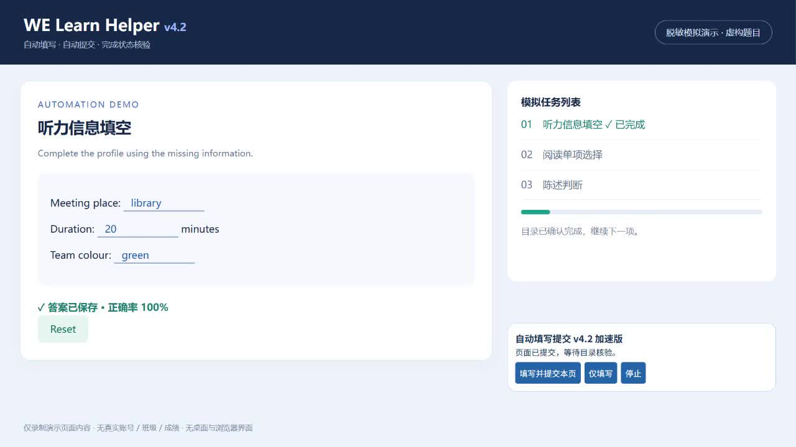

# WE Learn Helper

WE Learn 练习辅助用户脚本，适配 `et-blank`、`et-choice`、`et-tof` 三类控件，支持填写、提交和从课程目录批量处理未完成项。

## 安装

1. 安装 Tampermonkey。
2. 新建用户脚本，将 [welearn-auto.user.js](welearn-auto.user.js) 的全部内容粘贴进去并保存。
3. 停用其他同时操作同一课程的脚本，刷新课程页。

## 使用

- **当前页**：点击“填写并提交本页”，或者使用“仅填写”核对答案。
- **批量**：在课程目录点击“从目录批量开始 / 继续”。提交后返回目录，只有目录显示完成标记才记录为成功。
- **停止与记录**：可停止批量、继续原队列，并导出处理记录。

## 效果视频

[观看或下载脱敏演示视频](docs/demo.mp4)

视频使用虚构题目与本地模拟课件接口，展示发布脚本的填写和提交交互。演示中的任务调度和保存反馈由模拟页面提供，不连接真实课程、账号或成绩，不能作为实际课程全量适配的证明。

演示没有录制真实桌面、浏览器栏、账号、班级、个人资料或本机路径。视频无音轨。

## 功能范围

支持填空、选择和判断题；录音、演讲、拖拽及其他未适配控件记录为待处理。找不到答案或无法确认提交时，不计为成功。

当前版本 **4.2.0**。它检查 Submit 及其外层容器的隐藏状态，减少提交成功后仍等待超时的情况；保留完成状态核验。

早期排查参考了 [WeLearn-Go](https://github.com/noxsk/WeLearn-Go) 的适配思路。本仓库不包含该项目的完整副本，也不包含课件源码、题库、用户截图或账号数据。

## 本地演示

用任意静态 HTTP 服务器打开仓库中的 `demo/index.html`。页面使用最小模拟控件接口，供观察脚本交互；这不是 WE Learn 官方页面。

脚本在实际平台的行为受课程页面结构、网络响应和平台规则影响。请按课程要求使用。
